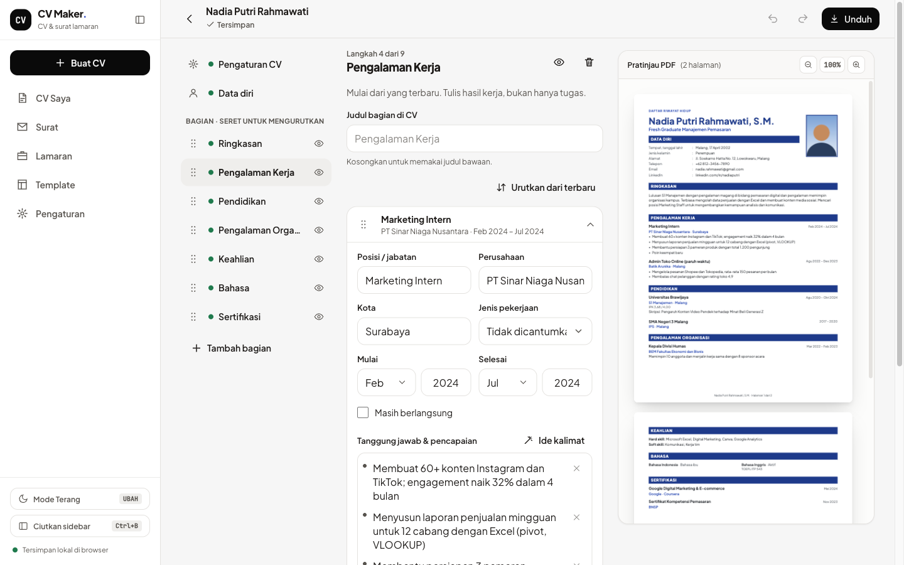

# CV Maker — CV & Surat Lamaran

[](https://www.typescriptlang.org/)
[](https://react.dev/)
[](https://react-pdf.org/)
[](docs/teknis.md)
[](docs/teknis.md)
[](LICENSE)
[](https://github.com/rizalahmaddd/cv-maker/actions/workflows/ci.yml)
[](https://cv.solusikoding.com)

<p align="center">
  
</p>

**Stack:** TypeScript · React 18 · Vite · Tailwind CSS 4 · [Dexie](https://dexie.org) (IndexedDB) · [@react-pdf/renderer](https://react-pdf.org) · [PDF.js](https://mozilla.github.io/pdf.js/) · [docx](https://docx.js.org) · Fontsource · Workbox (PWA) · Cloudflare Workers

Aplikasi pembuat CV dan surat lamaran untuk pencari kerja, mahasiswa, dan fresh graduate di Indonesia, baik untuk melamar di dalam negeri maupun ke luar negeri. Isi data sekali, pilih dari 30 template (siap ATS, formal dengan foto, Daftar Riwayat Hidup, Europass, sampai Rirekisho Jepang), lalu unduh sebagai PDF, Word, gambar, atau teks. Semua data tersimpan di perangkat Anda, tanpa akun dan tanpa server. Bisa dipasang sebagai aplikasi (PWA) dan tetap jalan offline.

🌐 **Coba demo:** [cv.solusikoding.com](https://cv.solusikoding.com)

## Fitur

### Buat CV
- **Mulai sesuai kebutuhan**: Fresh graduate, mahasiswa (magang/PKL/beasiswa), sudah berpengalaman, atau kerja di luar negeri; bagian CV menyesuaikan
- **11 preset negara tujuan**: Indonesia, Malaysia, Singapura, Timur Tengah, Jepang, Korea, Australia, Inggris, Eropa, AS/Kanada; foto, data pribadi, ukuran kertas, dan bahasa ikut diatur
- **17 jenis bagian**: Pengalaman kerja, magang, pendidikan, organisasi, kepanitiaan, proyek, keahlian, bahasa, sertifikasi, pelatihan, prestasi, publikasi, referensi, dan bagian bebas
- **Isian yang tepat**: Jenjang pendidikan, IPK dengan skala 4/5/100, jenis kelamin, agama, status, jenis pekerjaan, dan SIM berupa pilihan; tinggi/berat dan tahun hanya angka
- **Poin pengalaman per baris**: Enter untuk poin baru, tempel teks dari Word/WhatsApp langsung terpecah jadi poin
- **Bank kalimat**: Contoh ringkasan, ide poin pengalaman, dan saran keahlian untuk 13 bidang kerja (ID & EN)
- **Foto**: Potong ke pas foto 3×4 atau persegi, geser, zoom, putar, dan pinch di HP
- **Tersimpan otomatis** dengan urungkan/ulangi, aman dibuka di dua tab sekaligus

### Template & desain
- **30 template dalam 11 layout**: Klasik/Harvard, Garis Waktu, Modern, Europass, Formal, Daftar Riwayat Hidup (bernomor, F4), Rirekisho 履歴書, Sidebar, Timeline, Kepala Warna, dan Kreatif
- **Label ATS** di setiap template (Siap / Cukup / Kurang), plus unduh **PDF versi ATS** sekali ketuk
- **Editor template**: Palet warna, 15 font dan pasangan font, gaya judul, kepadatan, margin, bentuk foto, tampilan keahlian (teks, label, titik, batang), ukuran kertas A4/Letter/F4/Legal, dan judul bagian per bahasa
- **Muat dalam 1 halaman**: Huruf dan jarak dikecilkan sedikit bila isi melewati satu halaman

### Unduh & kirim
- **PDF** dengan teks yang bisa dibaca ATS, tautan aktif, dan metadata
- **Word (.docx)** yang bisa diedit di Word, Google Docs, dan WPS
- **Gambar PNG/JPG** per halaman atau satu gambar panjang
- **Teks, Markdown, JSON Resume**, dan **paket ZIP** (PDF + Word + teks + foto)
- **Bagikan** langsung ke WhatsApp/email dari HP, atau cetak

### Cek CV
- **Pemeriksaan otomatis**: Kontak, format email dan nomor HP, tanggal yang terbalik, tautan rusak, poin tanpa angka, jumlah halaman, teks contoh yang belum diganti, dan NIK yang tak sengaja tercantum
- **Aturan per negara**: Misalnya foto dan agama tidak disarankan untuk CV ke AS/Inggris/Australia
- **Cocokkan dengan lowongan**: Tempel teks lowongan, lihat kata kunci yang sudah dan belum ada di CV (diproses di perangkat)

### Surat lamaran & pelacak
- **Surat lamaran** format resmi Indonesia (Perihal, Lampiran, Kepada Yth.) dan cover letter bahasa Inggris, terisi otomatis dari CV, dengan 5 template paragraf, daftar berkas lampiran, dan tanda tangan (latar putih dihapus otomatis)
- **Pelacak lamaran**: Status dari dilamar sampai diterima, pengingat follow-up, CV yang dikirim, dan ekspor CSV

### Impor & data
- **Impor CV lama** dari PDF (termasuk PDF profil LinkedIn), teks yang ditempel, atau JSON Resume, lalu periksa hasilnya sebelum disimpan
- **Backup & pindah perangkat**: Ekspor ke satu file JSON, lalu gabungkan atau ganti di perangkat lain
- **100% di perangkat & privat**: Data dan foto tidak pernah dikirim ke server
- **PWA & offline**, responsif di HP, tablet, dan desktop, dengan tema terang/gelap

## Cara kerja

1. Buka [cv.solusikoding.com](https://cv.solusikoding.com) atau pasang sebagai aplikasi.
2. Pilih keperluan dan negara tujuan, lalu mulai dari kosong, contoh, atau impor CV lama.
3. Isi tiap bagian; pratinjau PDF berubah langsung.
4. Buka **Lihat & unduh**: perbaiki saran dari Cek CV, lalu unduh atau bagikan.

## Mulai cepat

```bash
npm install       # pasang dependensi
npm run dev       # jalankan di http://localhost:5173
npm test          # unit test
npm run build     # build produksi ke folder dist/
```

## Dokumentasi

- [Dokumentasi Teknis](docs/teknis.md): arsitektur, penyimpanan data, mesin PDF & template, ekspor, impor, pemeriksa CV, cache & PWA, serta build & deploy

## Dukung & Donasi

Jika proyek ini bermanfaat bagi Anda, dukung pengembangannya melalui **QRIS**:

<p align="center">
  
  <br>
  <em>Scan QRIS menggunakan BCA, Mandiri, BRI, GoPay, OVO, DANA, ShopeePay, atau mobile banking lainnya.</em>
</p>

## Kontak

Dikembangkan oleh **rizalahmaddd**:
- **WhatsApp**: [+62 857-7777-5477](https://wa.me/6285777775477)
- **GitHub**: [@rizalahmaddd](https://github.com/rizalahmaddd)
- **Lokasi**: Kota Malang, Jawa Timur, Indonesia

## Lisensi

Proyek ini dilisensikan di bawah lisensi [MIT License](LICENSE).
Font yang dibundel (Plus Jakarta Sans, Inter, IBM Plex Sans, Space Grotesk, Poppins, Montserrat, Outfit, Lora, Playfair Display, Fraunces, DM Serif Display, JetBrains Mono, Space Mono, Arimo, Tinos, Noto Sans JP) memakai SIL Open Font License 1.1, rinciannya ada di [Dokumentasi Teknis](docs/teknis.md#11-lisensi-font).
